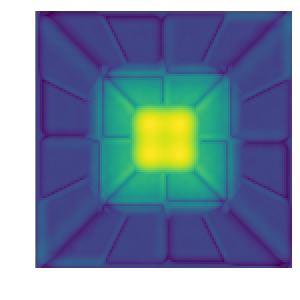
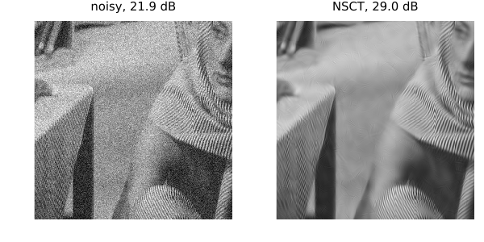

# Contourlets.jl

[](https://github.com/hakkelt/Contourlets.jl/actions/workflows/CI.yml)
[](https://github.com/hakkelt/Contourlets.jl/actions/workflows/lint.yml)
[](https://hakkelt.github.io/Contourlets.jl/stable/)
[](https://hakkelt.github.io/Contourlets.jl/dev/)
[](https://codecov.io/gh/hakkelt/Contourlets.jl)
[](https://github.com/JuliaTesting/Aqua.jl)
[](https://github.com/aviatesk/JET.jl)
[](https://github.com/fredrikekre/Runic.jl)
[](LICENSE)

Contourlet transforms of images: the contourlet transform (CT), the
nonsubsampled contourlet transform (NSCT), and the translation-invariant (TICT)
and semi-translation-invariant (STICT) contourlet transforms.

A contourlet transform splits an image by scale, like a wavelet transform, and
splits each scale by orientation. Each subband holds the edges of one scale
and one range of directions, so images with smooth curved edges are
represented by fewer coefficients than with separable wavelets. This helps
denoising, compression and compressed-sensing reconstruction.

| Frequency tiling of a CT | Denoising with the NSCT |
|:---:|:---:|
|  |  |

```julia
using Contourlets

img = randn(256, 256)
t = NSCT(scales = 3, direction_levels = [2, 3, 3])
c = analyze(t, img)                  # 256 × 256 × 21 array of subbands
subband_layout(t, size(img))[2]      # (scale = 1, direction = 1)
synthesize(t, c) ≈ img               # true
```

## Installation

Contourlets.jl and its dependencies MultiscaleTransformsBase.jl and
MultiscaleFilterBanks.jl are not registered yet. Clone the three repositories
side by side and develop them into your environment:

```bash
git clone https://github.com/hakkelt/MultiscaleTransformsBase.jl MultiscaleTransformsBase
git clone https://github.com/hakkelt/MultiscaleFilterBanks.jl MultiscaleFilterBanks
git clone https://github.com/hakkelt/Contourlets.jl Contourlets
```

```julia
using Pkg
Pkg.develop([PackageSpec(path = "MultiscaleTransformsBase"),
             PackageSpec(path = "MultiscaleFilterBanks"),
             PackageSpec(path = "Contourlets")])
```

## Documentation

The [documentation](https://hakkelt.github.io/Contourlets.jl/dev/) has how-to
guides (choosing a transform, workspaces for repeated calls, denoising, threads
and GPUs, the pyramid and filter-bank stages), a theory page with the papers the
transforms come from, and the API reference.

## Related packages

[Surfacelets.jl](https://github.com/hakkelt/Surfacelets.jl) provides the
surfacelet transform for volumes, and
[Shearlets.jl](https://github.com/hakkelt/Shearlets.jl) 2-D and 3-D shearlet
transforms. All three share the filters of
[MultiscaleFilterBanks.jl](https://github.com/hakkelt/MultiscaleFilterBanks.jl)
and the interface of
[MultiscaleTransformsBase.jl](https://github.com/hakkelt/MultiscaleTransformsBase.jl).

## Acknowledgments

The transforms are implemented from the papers that introduced them, listed on
the [theory page](https://hakkelt.github.io/Contourlets.jl/dev/theory/). The
authors' MATLAB toolboxes served as black-box references for validation only;
see [`NOTICE`](NOTICE).

## Disclaimer

This library was created with the assistance of [Claude](https://claude.com/claude-code),
[Antigravity](https://antigravity.google/), and
[GitHub Copilot](https://github.com/features/copilot).
