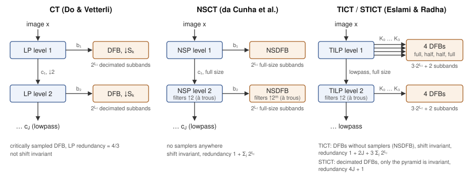

# [Theory](@id theory)

The constructions behind [`ct_forward`](@ref), [`nsct_forward`](@ref),
[`tict_forward`](@ref) and [`stict_forward`](@ref): a Laplacian pyramid for
scale, a directional filter bank for orientation, and the à trous variants of
both that make the NSCT and the TICT shift-invariant.  For in-depth
derivations see the references at the bottom; for the volume transforms, which
are a different construction rather than a generalisation of this one, see
[Surfacelets.jl](https://github.com/hakkelt/Surfacelets.jl).

```@setup theory
using Contourlets, Plots, FFTW
Plots.default(show = false)
```

All four transforms share one shape: a pyramid splits the image into a bandpass
and a coarser lowpass, a directional filter bank splits each bandpass by
orientation, and the lowpass is fed back into the next pyramid level.  They
differ only in which stages decimate:



| | CT | NSCT | TICT | STICT |
|---|---|---|---|---|
| Pyramid | Laplacian (↓2) | nonsubsampled (à trous) | translation-invariant LP, 4 channels | translation-invariant LP, 4 channels |
| Directional stage | DFB (↓``S_k``) | NSDFB | NSDFB | DFB (↓``S_k``) |
| Invariant to circular shifts | no | yes | yes | pyramid only |
| Redundancy | ``\approx 4/3`` | ``1 + \sum_j 2^{L_j}`` | ``1 + 2J + 3\sum_j 2^{L_j}`` | ``4J + 1`` |
| Choose it for | compression, sparse approximation | denoising, enhancement, features | denoising when shift invariance matters most | denoising with a TI pyramid at low redundancy |

## Laplacian Pyramid (LP)

The LP provides a multiscale decomposition without aliasing.

**Analysis** (one level, downsampling factor 2):
```
coarse   = ↓2 · (h ⊛ image)
pred     = g ⊛ (↑2 · coarse)
bandpass = image − pred
```

**Synthesis** (exact for any biorthogonal pair `(h, g)`):
```
rec = bandpass + g ⊛ (↑2 · coarse) = image
```

The default filter pair [`CDF97`](@ref) is the CDF 9/7 biorthogonal wavelet used
in JPEG 2000.  Its analysis low-pass ``h`` has unit gain at DC and a null at the
Nyquist frequency, so the bandpass image ``\text{image} - \text{pred}`` carries
exactly the detail removed by the coarse approximation:

```@example theory
ω = range(0, π; length = 400)
dtft(f, c) = [abs(sum(f[n] * cis(-w * (n - c)) for n in eachindex(f))) for w in ω]
plot(ω, dtft(CDF97.h, 5), label = "analysis h (low-pass)", lw = 2,
    xlabel = "ω", ylabel = "|H(ω)|", title = "CDF 9/7 low-pass response",
    xticks = ([0, π/2, π], ["0", "π/2", "π"]), legend = :topright)
plot!(ω, 1 .- dtft(CDF97.h, 5), label = "1 − h  (band/high-pass)", lw = 2, ls = :dash)
savefig("lp_response.png"); nothing # hide
```


## Directional Filter Bank (DFB)

The DFB partitions the 2-D frequency plane into ``2^L`` directional wedges using
a binary tree of two-channel quincunx filter banks (Bamberger & Smith 1992).  The
package follows the formulation of Do's thesis (§3.3), which the contourlet paper
(Do & Vetterli 2005) builds on:

1. Every split is a quincunx filter bank with **fan** filters.  Levels 1 and 2
   sample by ``Q_0`` and ``Q_1``, so after two levels the four channels are
   sampled by ``Q_0 Q_1 = 2I``.
2. From level 3 a node is split by a **resampled** quincunx bank — the fan pair
   seen through a shear ``R_i`` — of one of four types, chosen by the branch that
   led to the node; one half of the tree uses the other half's types with the two
   axes swapped.
3. By the multirate identities, each of the ``2^L`` channels is then a single
   filtering with an **equivalent filter**

   ```math
   H_k(\omega) = K_{t_1 t_2}(\omega) \prod_{i=2}^{L-1} F_{t_i t_{i+1}}\!\left((M_k^{(i)})^{T}\omega\right)
   ```

   followed by downsampling by ``M_k``, and a unimodular **backsampling** turns
   that into a diagonal ``S_k = \mathrm{diag}(2^{L-1}, 2)`` (or its transpose for
   the other half).  This is the thesis' multichannel view, its eq. (3.23):
   ``y_k[n] = (h_k \circledast x)[S_k n]``.

The implementation computes exactly that multichannel bank.  The ``H_k`` are
evaluated in closed form on the DFT grid, so each channel is a pointwise product,
a fold of the ``|\det S_k| = 2^L`` aliases and a small inverse FFT, and the
synthesis is the mirror image.  On a periodic image this is exact.  Every subband
commutes with input shifts on its own sampling lattice, and perfect
reconstruction holds at every depth, to machine precision.

The fan filters are the quincunx filters of Phoong et al. (1995, §V).  They lift
a 1-D two-channel ladder filter bank to the quincunx lattice by replacing its
filter ``\beta(z)`` with ``\beta(z_0 z_1^{-1})\beta(z_0 z_1)``.  With
``b(\theta) = 2\sum_k v_k \cos((k-\tfrac12)\theta)``, the zero-phase part of
``\beta``, and ``p(\omega) = b(\omega_0 + \omega_1)\, b(\omega_0 - \omega_1)``:

```math
H_0 = \frac{1 + p}{\sqrt2},\quad
H_1 = e^{j\omega_0}\frac{2 - p - p^2}{\sqrt2},\quad
G_0 = \frac{2 + p - p^2}{\sqrt2},\quad
G_1 = e^{-j\omega_0}\frac{1 - p}{\sqrt2},
```

a diamond-shaped pair satisfying the quincunx perfect-reconstruction conditions.
Modulating it by ``\pi`` in ``\omega_0`` gives the fan pair.

The ``2^L`` subbands are genuine directional wedges.  For ``L \ge 2`` the first
``2^{L-1}`` are ``n_1/2^{L-1} \times n_2/2`` and capture mostly-horizontal
orientations; the rest are ``n_1/2 \times n_2/2^{L-1}`` and capture
mostly-vertical ones.  The channel order and the coefficients for ``L \le 2``
coincide with the MATLAB Contourlet Toolbox.  From ``L = 3`` the toolbox's tree is
not equivariant on its sampling lattices, so the two differ.  Modulation-mode
filter pairs instead use a simpler shear-based tree that is perfect-reconstructing
but only weakly directional.

Reconstructing a single coefficient from each subband reveals the **directional
basis functions** — elongated, oriented elements (the anisotropy that lets
contourlets trace smooth contours):

```@example theory
N = 128
sbs = dfb_decompose(zeros(N, N), 3, Q2345)     # 8 directional subbands
function basis_element(k)
    s = [zeros(size(sb)) for sb in sbs]
    s[k][size(s[k], 1) ÷ 2 + 1, size(s[k], 2) ÷ 2 + 1] = 1.0
    b = dfb_reconstruct(s, Q2345)
    return b .- sum(b) / length(b)   # drop the DC the wedge owning ω=0 carries
end

# Crop to the central support and use symmetric colour limits so the oriented
# ridge is visible (the basis functions are well-localised, so most of the
# N×N canvas is empty).
p = plot(layout = (2, 4), size = (860, 440))
w = 24
for k in 1:8
    b = basis_element(k)
    c1, c2 = size(b, 1) ÷ 2, size(b, 2) ÷ 2
    bc = b[(c1 - w + 1):(c1 + w), (c2 - w + 1):(c2 + w)]
    cl = maximum(abs, bc)
    heatmap!(p[k], bc, color = :RdBu, clims = (-cl, cl), title = "subband $k",
        aspect_ratio = :equal, axis = false, colorbar = false)
end
savefig(p, "dfb_basis.png"); nothing # hide
```


In the frequency domain each channel occupies a complementary **wedge**, and the
channels together tile the 2-D plane — the directional partition that gives the
contourlet its name.  This is clearest with a coarser **two-level**
(four-channel) DFB: its decimated subbands are large enough that each passband
shows without the spectral folding that makes the deeper (`l = 3`) subbands hard
to read one at a time.  The four passbands together cover the whole plane (a
smaller `Nf = 64` window is used so each basis function fills its channel's
passband — at larger sizes the single reconstructed atom localises and its
spectrum shrinks to a blob inside the support):

```@example theory
Nf = 64
sbs2 = dfb_decompose(zeros(Nf, Nf), 2, Q2345)   # 4 channels: legible per-subband spectra
pf = plot(layout = (1, 4), size = (860, 220))
for k in 1:4
    s = [zeros(size(sb)) for sb in sbs2]
    s[k][size(s[k], 1) ÷ 2 + 1, size(s[k], 2) ÷ 2 + 1] = 1.0
    spec = log1p.(abs.(fftshift(fft(dfb_reconstruct(s, Q2345)))))
    heatmap!(pf[k], spec, color = :viridis, title = "subband $k",
        aspect_ratio = :equal, axis = false, colorbar = false)
end
savefig(pf, "dfb_freq.png"); nothing # hide
```


The partition itself is easiest to read without the decimation.  The NSDFB uses
the same equivalent filters ``H_k`` at full rate, so its impulse responses show
each ``|H_k|`` directly.  Colouring every frequency by the channel with the
largest response, and labelling each wedge with its subband index, gives the
partition of an ``l = 3`` bank (compare Do's thesis, Fig. 3.6).  The half trees that the TICT and STICT use on two of their pyramid
channels (`half = :first` / `:second`; Eslami & Radha 2006, Fig. 7) keep one
level-1 fan whole:

```@example theory
Nw = 128
δ = zeros(Nw, Nw); δ[1, 1] = 1.0
midw = Nw ÷ 2 + 1
# Channel owning each frequency: the argmax of |H_k| over the centred DFT grid.
function wedge_owner(l, half)
    resp = [fftshift(abs.(fft(s))) for s in nsdfb_decompose(δ, l, Q2345; half = half)]
    return [argmax([r[i, j] for r in resp]) for i in 1:Nw, j in 1:Nw]
end
# One label per wedge: the mean orientation of its pixels (averaged on the
# doubled angle, so the two opposite lobes of a wedge agree), at 60 % radius.
function wedge_labels(owner)
    labels = []
    for k in 1:maximum(owner)
        z = sum(cis(2 * atan(I[1] - midw, I[2] - midw))
            for I in findall(==(k), owner) if I != CartesianIndex(midw, midw))
        θ = angle(z) / 2
        r = 0.6 * (Nw ÷ 2)
        push!(labels, (midw + r * cos(θ), midw + r * sin(θ), text(string(k), 11, :white)))
    end
    return labels
end
pw = plot(layout = (1, 3), size = (900, 320))
for (i, (half, ttl)) in enumerate(((:both, "l = 3"), (:first, "l = 3, half = :first"),
        (:second, "l = 3, half = :second")))
    owner = wedge_owner(3, half)
    heatmap!(pw[i], owner; color = cgrad(:tab10, maximum(owner); categorical = true),
        title = ttl, aspect_ratio = :equal, axis = false, colorbar = false,
        annotations = wedge_labels(owner))
end
savefig(pw, "dfb_wedges.png"); nothing # hide
```


Horizontal frequency runs left to right and vertical frequency bottom to top,
with ``\omega = 0`` in the centre.

The default pair [`Q2345`](@ref) is the "23-45" biorthogonal pair of Phoong et
al. (1995), whose ladder filter ``\beta`` is the 12-tap design of their
Example 3.2.  Its 2-D analysis filters have ``23 \times 23`` and ``45 \times 45``
support, hence the name.  Perfect reconstruction holds for any ``\beta``
(``< 10^{-15}`` at every tree depth).

The narrowest wedges, the two beside each ``\pm 45°`` fan boundary, are
``3.6°`` wide at ``L = 5``.  That is less than the transition band of the 12-tap
fan filters, so a plane wave at those angles puts more energy in a neighbouring
wedge.  This is a property of the filters, not of the construction: the MATLAB
toolbox behaves the same way.

## Pyramid Directional Filter Bank (PDFB) — Contourlet Transform

The CT couples `J` LP levels with one DFB per bandpass:

```
coarse ← image
for j = 1 … J:
    coarse_j, bandpass_j = LP(coarse, h, g)
    subbands[j]          = DFB(bandpass_j, L_array[j], h_q, g_q)
    coarse               = coarse_j
```

**Parabolic scaling** chooses the direction count so that the spatial support
of directional subbands satisfies the parabolic scaling law
``\text{width} \sim \text{length}^2``:

```math
L_j = L_{j_0} + \left\lfloor \frac{j_0 - j}{2} \right\rfloor, \quad j = 1, \ldots, J
```

Use [`parabolic_levels`](@ref) to generate ``L_\text{array}`` automatically.

In the frequency domain, the Contourlet Transform partitions the 2-D plane into
concentric rings (from the Laplacian Pyramid) which are then subdivided into 
angular wedges (from the DFB):

```@example theory
N = 128
params = ContourletParams(J=2, L_array=[2, 1])
composite_freq = zeros(N, N)

# Compute frequency response of the coarse low-pass level
c = ct_forward(zeros(N, N), params)
c.coarse[size(c.coarse,1)÷2+1, size(c.coarse,2)÷2+1] = 1.0
composite_freq .= max.(composite_freq, abs.(fftshift(fft(ct_inverse(c, params)))))

# Compute frequency responses of all directional wedges across both scales
for j in 1:length(c.subbands)
    for k in 1:length(c.subbands[j])
        c_dir = ct_forward(zeros(N, N), params)
        c_dir.subbands[j][k][size(c_dir.subbands[j][k],1)÷2+1, size(c_dir.subbands[j][k],2)÷2+1] = 1.0
        composite_freq .= max.(composite_freq, abs.(fftshift(fft(ct_inverse(c_dir, params)))))
    end
end

p_ct = heatmap(log1p.(composite_freq), color = :viridis, title = "Contourlet Frequency Tiling",
    aspect_ratio = :equal, axis = false, colorbar = false, size=(400, 400))
savefig(p_ct, "ct_tiling.png"); nothing # hide
```


In space the same partition gives the **contourlet basis images**: one
coefficient reconstructed alone.  Each is an oriented, elongated element whose
size doubles from one scale to the next, while its orientation is set by the
directional subband.  Below, rows are scales 1 (finest) to 3 and columns four
of the directional subbands at each scale; the crop doubles with the scale:

```@example theory
Na = 256
pa = ContourletParams(J = 3, L_array = [3, 3, 2])
function ct_atom(j, k)
    c = ct_forward(zeros(Na, Na), pa)
    sb = c.subbands[j][k]
    sb[size(sb, 1) ÷ 2 + 1, size(sb, 2) ÷ 2 + 1] = 1.0
    return ct_inverse(c, pa)
end
pat = plot(layout = (3, 4), size = (860, 660))
for j in 1:3
    n = 2^pa.L_array[j]
    for (col, k) in enumerate(round.(Int, range(1, n; length = 4)))
        a = ct_atom(j, k)
        i0, j0 = Tuple(argmax(abs.(a)))
        w = 8 * 2^(j - 1)                       # half-width of the crop
        r0 = clamp(i0 - w, 1, Na - 2w + 1)
        c0 = clamp(j0 - w, 1, Na - 2w + 1)
        ac = a[r0:(r0 + 2w - 1), c0:(c0 + 2w - 1)]
        cl = maximum(abs, ac)
        heatmap!(pat[(j - 1) * 4 + col], ac; color = :RdBu, clims = (-cl, cl),
            title = "scale $j, dir $k", aspect_ratio = :equal, axis = false,
            colorbar = false, yflip = true)
    end
end
savefig(pat, "ct_atoms.png"); nothing # hide
```


## Nonsubsampled Contourlet Transform (NSCT)

The NSCT replaces every decimated filter bank with its non-subsampled (à trous)
counterpart:

- **NSP**: at LP level ``j``, the filters ``h, g`` are replaced by
  ``h_j = h`` upsampled by ``2^{j-1}`` (inserting ``2^{j-1}-1`` zeros between
  taps).  No downsampling is applied, so all outputs have the same size as the
  input.
- **NSDFB**: da Cunha et al. switch off the samplers of every two-channel bank
  in the DFB tree and upsample the filters below them accordingly.  By the
  multirate identities each channel is then a single filtering with the DFB's
  equivalent filter ``H_k`` above, so the NSDFB filters the bandpass with each
  ``H_k`` at full rate.  The delays that only position the decimation lattice
  are dropped, so every subband stays registered with the input.  Scaling the
  filters by ``2^{-L/2}`` makes ``\sum_k G_k H_k = 1``: perfect reconstruction
  at every depth.
- **Coarse scales**: the fan filters' transition bands all meet at the origin,
  so near ``\omega = 0`` every directional filter resolves direction poorly, and
  the bandpass of a coarse pyramid level lies exactly there.  da Cunha et al.
  (§II-A.3) therefore filter level ``j`` with ``U_k(z^{2^m I})``, i.e.
  ``U_k(2^m\omega)``, which stretches the well-resolved region over the coarser
  band; their example upsamples the last two stages of a five-scale NSCT by
  ``2I``.  The paper leaves ``m`` open.  This package uses ``m = \max(0, j-2)``:
  for its CDF 9/7 pyramid and every depth ``L = 1, \dots, 5``, that minimises the
  share of each level's bandpass energy falling outside the subband's ideal
  wedge — 0.04 to 0.28 at every level, against 0.40 to 0.83 at ``j = 5`` without
  upsampling.  A larger ``m`` folds the pyramid's leakage back across the
  replicas of the upsampled filter.  Perfect reconstruction is unaffected.

All NSP and NSDFB filtering uses periodic (circular) convolution, so the NSCT is
**invariant under circular shifts**: a circular shift of the input produces the
same circular shift in every subband, with no redistribution of energy.  The
cost is redundancy proportional to ``1 + \sum_{j=1}^J 2^{L_j}``.

The frequency tiling remains the same as the decimated CT, but every basis element
is perfectly shift-invariant. We can visualize the equivalent frequency partition
of a 2-level NSCT:

```@example theory
N_nsct = 64
params_nsct = ContourletParams(J=2, L_array=[2, 1])
ref_nsct = nsct_forward(zeros(N_nsct, N_nsct), params_nsct)
n_l1 = length(ref_nsct.subbands[1])   # 4  (2^L_array[1])
n_l2 = length(ref_nsct.subbands[2])   # 2  (2^L_array[2])
mid = N_nsct ÷ 2 + 1

function nsct_spec(params, j, k)        # j=0 → coarse
    c = nsct_forward(zeros(N_nsct, N_nsct), params)
    if j == 0
        c.coarse[mid, mid] = 1.0
    else
        c.subbands[j][k][mid, mid] = 1.0
    end
    log1p.(abs.(fftshift(fft(nsct_inverse(c, params)))))
end

# Layout: row 1 = 4 finest-scale subbands, row 2 = 2 coarser subbands + coarse LP + composite
p_nsct = plot(layout = (2, 4), size = (860, 440))

for k in 1:n_l1
    heatmap!(p_nsct[k], nsct_spec(params_nsct, 1, k), color = :viridis,
        title = "scale 1, dir $k", aspect_ratio = :equal, axis = false, colorbar = false)
end
for k in 1:n_l2
    heatmap!(p_nsct[n_l1 + k], nsct_spec(params_nsct, 2, k), color = :viridis,
        title = "scale 2, dir $k", aspect_ratio = :equal, axis = false, colorbar = false)
end
heatmap!(p_nsct[n_l1 + n_l2 + 1], nsct_spec(params_nsct, 0, 0), color = :viridis,
    title = "coarse LP", aspect_ratio = :equal, axis = false, colorbar = false)

# Composite: per-pixel max across all channels
composite_nsct = zeros(N_nsct, N_nsct)
composite_nsct .= max.(composite_nsct, exp.(nsct_spec(params_nsct, 0, 0)) .- 1)
for j in 1:length(ref_nsct.subbands), k in 1:length(ref_nsct.subbands[j])
    composite_nsct .= max.(composite_nsct, exp.(nsct_spec(params_nsct, j, k)) .- 1)
end
heatmap!(p_nsct[n_l1 + n_l2 + 2], log1p.(composite_nsct), color = :viridis,
    title = "composite", aspect_ratio = :equal, axis = false, colorbar = false)

savefig(p_nsct, "nsct_tiling.png"); nothing # hide
```


## [Translation-invariant contourlets (TICT, STICT)](@id theory-tict)

Eslami & Radha (2006) build a translation-invariant contourlet transform by
taking every shift of the decimated one, through a "generalized algorithme à
trous": in a multilevel filter bank with sampling matrix ``M``, dropping the
samplers and filtering level ``i`` with ``H(z^{M^{i-1}})`` instead of ``H(z)``
gives all shifts at once (their Proposition 1).

**TILP.** They apply this to the Laplacian pyramid written as an oversampled
filter bank (Do & Vetterli 2003).  With ``M = 2I`` and the coset
representatives ``k_c \in \{(0,0), (1,0), (0,1), (1,1)\}``, one pyramid level is
the lowpass ``H`` and four highpass channels — the polyphase components of the
detail image:

```math
K_c(z) = z^{k_c} - G_c(z^M)\,H(z), \qquad
F_c(z) = z^{-k_c} - G(z)\,H_c(z^M),
```

with ``G_c(z) = {\downarrow_M}\{z^{k_c}G(z)\}`` and
``H_c(z) = {\downarrow_M}\{z^{-k_c}H(z)\}``.  Without samplers,
``\tfrac14\,(GH + \sum_c F_c K_c) = 1`` whenever ``h`` and ``g`` are
biorthogonal (their Proposition 2), so every level reconstructs exactly with a
factor ``\tfrac14``.  The translation-invariant Laplacian pyramid (TILP) has
redundancy ``4J + 1``.  Downsampling its level-``i`` channels by ``2^i`` gives
the decimated pyramid's channels for every position of the sampling lattice;
the test suite checks this against an independent pyramid.

The package evaluates every TILP filter in closed form on the DFT grid.  The
polyphase components follow from
``G_c(M\omega) = \tfrac14 \sum_{a \in \{0,\pi\}^2} e^{j(\omega+a)\cdot k_c}\,G(\omega+a)``,
and each level's cascade folds into one mask per channel.

The magnitude responses of the four highpass channels of the first level, and
of the lowpass, show why the channels are treated differently below (compare
Eslami & Radha, Fig. 6).  ``K_0`` and ``K_3`` split their energy evenly between
the two level-1 fans, while about 60 % of ``K_1``'s energy lies in the fan
around the vertical-frequency axis (``|\omega_\text{row}| > |\omega_\text{col}|``)
and 60 % of ``K_2``'s in the other one:

```@example theory
Nt = 64
δt = zeros(Nt, Nt); δt[1, 1] = 1.0
# The analysis of an impulse is each channel's impulse response.
t0 = tict_forward(δt, ContourletParams(J = 1, L_array = [0]))
ptl = plot(layout = (1, 5), size = (900, 210))
for c in 1:4
    heatmap!(ptl[c], fftshift(abs.(fft(t0.subbands[1][c][1]))); color = :viridis,
        title = "K$(c - 1)", aspect_ratio = :equal, axis = false, colorbar = false)
end
heatmap!(ptl[5], fftshift(abs.(fft(t0.coarse))); color = :viridis,
    title = "lowpass", aspect_ratio = :equal, axis = false, colorbar = false)
savefig(ptl, "tilp_channels.png"); nothing # hide
```


**Directional stage.** A DFB splits each of the four highpass channels.  For
the TICT it is the translation-invariant DFB: the DFB with its samplers
suppressed and scaled by ``2^{-L}``, which is this package's NSDFB.  For the
STICT it is the critically sampled DFB, which leaves the redundancy at
``4J + 1``.  Following the channels' passbands, ``K_0`` and ``K_3`` get the full
tree, while ``K_1`` and ``K_2`` get the "vertical" and "horizontal" DFBs.  These
are half trees that split only one of the two level-1 fans and keep the other
whole.  ``K_1`` (the shift along the rows) carries most of its energy in the fan
``|\omega_\text{row}| > |\omega_\text{col}|`` and ``K_2`` in the other, so each
splits the fan its energy is in.  A level of depth ``L \ge 1`` then has
``3 \cdot 2^L + 2`` TICT subbands.

The frequency support of every TICT subband of one level with ``L = 2`` is the
product of a TILP channel and a directional filter.  Rows are the channels
``K_0`` to ``K_3``: the full trees give four subbands, the half trees three:

```@example theory
t2 = tict_forward(δt, ContourletParams(J = 1, L_array = [2]))
pts = plot(layout = (4, 4), size = (760, 760))
for c in 1:4, d in 1:4
    i = (c - 1) * 4 + d
    if d <= length(t2.subbands[1][c])
        heatmap!(pts[i], fftshift(abs.(fft(t2.subbands[1][c][d]))); color = :viridis,
            title = "K$(c - 1), dir $d", aspect_ratio = :equal, axis = false,
            colorbar = false)
    else
        plot!(pts[i]; framestyle = :none, grid = false, ticks = false)
    end
end
savefig(pts, "tict_tiling.png"); nothing # hide
```


The STICT uses the same filters with the decimated DFB, so its subbands have the
same frequency supports.  What it gives up is the directional stage's
invariance: each STICT subband commutes only with shifts on its own sampling
lattice, as a DFB subband does.

The directional filters are the same at every level, as in the paper.  Unlike
the NSCT's pyramid, the TILP keeps the decimated pyramid's aliasing: at coarse
levels most of a channel's energy sits at high frequencies.  Measured as for the
NSCT above, the unmodified filters leak least at every TILP level, so no
coarse-scale upsampling is applied.

## References

1. M. N. Do and M. Vetterli, "The Contourlet Transform: An Efficient Directional
   Multiresolution Image Representation," *IEEE Trans. Image Process.*,
   14(12):2091–2106, 2005 — the contourlet transform and parabolic scaling.
2. A. L. da Cunha, J. Zhou, and M. N. Do, "The Nonsubsampled Contourlet Transform:
   Theory, Design, and Applications," *IEEE Trans. Image Process.*,
   15(10):3089–3101, 2006 — the NSP, the NSDFB and their coarse-scale upsampling.
3. R. H. Bamberger and M. J. T. Smith, "A Filter Bank for the Directional
   Decomposition of Images: Theory and Design," *IEEE Trans. Signal Process.*,
   40(4):882–893, 1992 — the directional filter bank.
4. M. N. Do, *Directional Multiresolution Image Representations*, PhD thesis,
   EPFL, 2001 — §3.2 (resampling, quincunx filter banks) and §3.3 (the DFB as a
   multichannel filter bank).
5. S.-M. Phoong, C. W. Kim, P. P. Vaidyanathan, and R. Ansari, "A New Class of
   Two-Channel Biorthogonal Filter Banks and Wavelet Bases," *IEEE Trans. Signal
   Process.*, 43(3):649–665, 1995 — the ladder filter banks, their quincunx
   mapping and the "23-45" (pkva) filters.
6. P. J. Burt and E. H. Adelson, "The Laplacian Pyramid as a Compact Image Code,"
   *IEEE Trans. Commun.*, 31(4):532–540, 1983.
7. A. Cohen, I. Daubechies, and J.-C. Feauveau, "Biorthogonal Bases of Compactly
   Supported Wavelets," *Commun. Pure Appl. Math.*, 45(5):485–560, 1992 — the CDF
   9/7 pyramid filters.
8. M. J. Shensa, "The Discrete Wavelet Transform: Wedding the À Trous and Mallat
   Algorithms," *IEEE Trans. Signal Process.*, 40(10):2464–2482, 1992.
9. R. Eslami and H. Radha, "Translation-Invariant Contourlet Transform and Its
   Application to Image Denoising," *IEEE Trans. Image Process.*,
   15(11):3362–3374, 2006 — the TILP, the TICT and the STICT.
10. M. N. Do and M. Vetterli, "Framing Pyramids," *IEEE Trans. Signal Process.*,
    51(9):2329–2342, 2003 — the Laplacian pyramid as an oversampled filter bank
    and its frame reconstruction.
