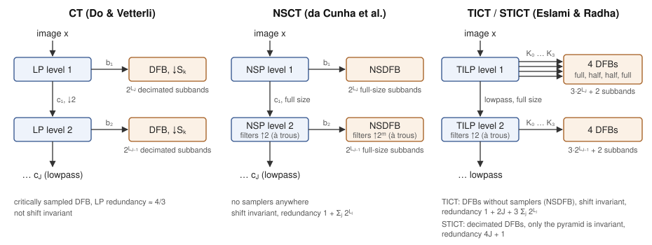

# [Theory](@id theory)

This page explains how the four transforms of Contourlets.jl are built and how
they differ. Signatures, keywords and size rules are in the
[API Reference](@ref api).

A *contourlet transform* splits an image by scale, like a wavelet transform,
and then splits each scale by orientation. Each output array, a *subband*,
holds the image content of one scale and one range of orientations. The
*redundancy* of a transform is its number of coefficients divided by the number
of pixels.

## Structure

All four transforms have two stages. A *pyramid* splits the image into a
bandpass image and a coarser lowpass image, and splits the lowpass image again
at the next scale. A *directional filter bank* splits each bandpass image into
``2^L`` orientations, where ``L`` is the depth chosen for that scale (the
`direction_levels` keyword). The transforms differ in which stages downsample:



| | CT | NSCT | TICT | STICT |
|---|---|---|---|---|
| Pyramid | Laplacian (↓2) | nonsubsampled | translation-invariant Laplacian, 4 channels | translation-invariant Laplacian, 4 channels |
| Directional stage | DFB (downsampled) | NSDFB | NSDFB | DFB (downsampled) |
| Commutes with circular shifts | no | yes | yes | pyramid only |
| Redundancy | ``\approx 4/3`` | ``1 + \sum_j 2^{L_j}`` | ``1 + 2J + 3\sum_j 2^{L_j}`` | ``1 + 4J`` |

Here ``J`` is the number of scales (`scales`) and ``L_j`` the directional depth
of scale ``j``. The TICT formula holds when every ``L_j \ge 1``.

A transform *commutes with circular shifts* when shifting the image circularly
shifts every subband by the same amount. The energy of each subband then does
not depend on where a feature sits in the image, which helps denoising. The
price is redundancy. The figure shows both for a random 128 × 128 image and
`scales = 3, direction_levels = [2, 3, 3]`. The vertical axis is the relative
change of the subband energies when the image is shifted by one pixel along
both axes:

```@example theory
using Contourlets, Plots, Random, LinearAlgebra
Plots.default(show = false)

x = randn(Xoshiro(1), 128, 128)
energies(t, c) = [sum(abs2, subband(t, c, i)) for i in 1:nsubbands(t, size(x))]
points = map((CT, STICT, NSCT, TICT)) do T
    t = T(scales = 3, direction_levels = [2, 3, 3])
    c = analyze(t, x)
    e = energies(t, c)
    e_shifted = energies(t, analyze(t, circshift(x, (1, 1))))
    (name = string(nameof(T)), redundancy = length(c) / length(x),
        change = max(norm(e_shifted - e) / norm(e), eps()))
end
for p in points
    println(rpad(p.name, 6), " redundancy ", rpad(round(p.redundancy; digits = 2), 6),
        " energy change ", round(p.change; sigdigits = 2))
end
scatter([p.redundancy for p in points], [p.change for p in points];
    xscale = :log10, yscale = :log10, legend = false, markersize = 6,
    series_annotations = [text("  " * p.name, 10, :left) for p in points],
    xlabel = "redundancy", ylabel = "energy change under a 1-pixel shift",
    xlims = (1, 200), ylims = (1e-17, 1), size = (560, 380))
savefig("redundancy_shift.png"); nothing # hide
```


For the NSCT and the TICT the change is rounding error.

## Laplacian pyramid

The Laplacian pyramid (Burt & Adelson 1983) of the CT computes, at each scale,

```
coarse   = ↓2 (h ⊛ image)
bandpass = image − g ⊛ (↑2 coarse)
```

where `h` and `g` are the analysis and synthesis lowpass filters, `⊛` is
convolution, `↓2` keeps every second sample along both axes and `↑2` inserts
zeros between samples. Synthesis adds the prediction back,
`image = bandpass + g ⊛ (↑2 coarse)`, which is exact for any filters. The
pyramid extends the image symmetrically at its borders. The default filters
[`CDF97`](@ref) are the CDF 9/7 biorthogonal wavelet filters (Cohen,
Daubechies & Feauveau 1992). The filter pairs and the pyramid come from
MultiscaleFilterBanks.jl, whose
[theory page](https://hakkelt.github.io/MultiscaleFilterBanks.jl/dev/theory/#The-Laplacian-pyramid) explains them in more detail.

## Directional filter bank

The directional filter bank (DFB) of Bamberger & Smith (1992) splits the
frequency plane into ``2^L`` wedges with a binary tree of two-channel quincunx
filter banks. Contourlets.jl follows the formulation in Do's thesis (2001,
§3.3): each of the ``2^L`` channels is one filtering with an *equivalent
filter* ``h_k``, the combination of the filters on the channel's path through
the tree, followed by downsampling by a diagonal matrix
``S_k = \mathrm{diag}(2^{L-1}, 2)`` (or its transpose):

```math
y_k[n] = (h_k \circledast x)[S_k n].
```

For ``L \ge 2`` the first ``2^{L-1}`` subbands have size
``n_1/2^{L-1} \times n_2/2`` and the rest ``n_1/2 \times n_2/2^{L-1}``. The
package evaluates the equivalent filters on the DFT grid, so the DFB treats the
bandpass image as periodic, and each subband commutes with the shifts that lie
on its own sampling lattice.

The two-channel filters are the quincunx filters of Phoong et al. (1995), built
from a one-dimensional ladder filter; perfect reconstruction holds for any
ladder filter. The default [`Q2345`](@ref) uses their 12-tap "23-45" design.

The *nonsubsampled* DFB (NSDFB) applies the same equivalent filters without
downsampling, so every subband keeps the size of its input and its impulse
responses show the frequency partition directly. Below, each frequency is
colored by the subband with the largest response, for depth ``L = 3``, with
``\omega = 0`` at the center, horizontal frequency left to right and vertical
frequency bottom to top. The TICT and STICT also use *half trees*
(`half = :first` and `half = :second`), which split only one of the two
first-level fans and keep the other whole:

```@example theory
using Contourlets: nsdfb_decompose
using FFTW

N = 128
δ = zeros(N, N); δ[1, 1] = 1.0
mid = N ÷ 2 + 1
# The subband with the largest frequency response at each frequency.
function wedge_owner(l, half)
    resp = [fftshift(abs.(fft(s))) for s in nsdfb_decompose(δ, Q2345, l; half)]
    return [argmax([r[i, j] for r in resp]) for i in 1:N, j in 1:N]
end
# One label per wedge, at the mean orientation of its frequencies.
function wedge_labels(owner)
    return map(1:maximum(owner)) do k
        z = sum(cis(2 * atan(I[1] - mid, I[2] - mid))
            for I in findall(==(k), owner) if I != CartesianIndex(mid, mid))
        θ = angle(z) / 2
        (mid + 0.6 * mid * cos(θ), mid + 0.6 * mid * sin(θ), text(string(k), 11, :white))
    end
end
pw = plot(layout = (1, 3), size = (900, 320))
for (i, half) in enumerate((:both, :first, :second))
    owner = wedge_owner(3, half)
    heatmap!(pw[i], owner; color = cgrad(:tab10, maximum(owner); categorical = true),
        title = "half = :$half", aspect_ratio = :equal, axis = false,
        colorbar = false, annotations = wedge_labels(owner))
end
savefig(pw, "dfb_wedges.png"); nothing # hide
```


At large depths the wedges beside the ±45° fan boundaries become narrower than
the transition band of the 12-tap filters, so a plane wave at those angles puts
most of its energy into a neighboring subband.

## Contourlet transform (CT)

The contourlet transform of Do & Vetterli (2005) applies a DFB to every
bandpass image of a Laplacian pyramid with ``J`` scales. Scales are numbered
from the coarsest (``j = 1``) to the finest (``j = J``); the lowpass image of
the coarsest level is the first subband.

*Parabolic scaling* chooses the depths so that the support of a basis element
satisfies width ≈ length²: the number of directions doubles at every other
scale towards the finest,

```math
L_j = L_1 + \left\lfloor \frac{j - 1}{2} \right\rfloor, \quad j = 1, \ldots, J.
```

[`parabolic_levels`](@ref) computes these depths. In frequency, the pyramid
gives concentric rings and the DFB splits each ring into wedges. The figure
shows, at each frequency, the largest response of all subbands of a CT with
`direction_levels = [1, 2]`:

```@example theory
tc = CT(scales = 2, direction_levels = [1, 2])
tiling = zeros(N, N)
for i in 1:nsubbands(tc, (N, N))
    c = analyze(tc, zeros(N, N))
    sb = subband(tc, c, i)
    sb[size(sb, 1) ÷ 2 + 1, size(sb, 2) ÷ 2 + 1] = 1.0   # one coefficient
    tiling .= max.(tiling, abs.(fftshift(fft(synthesize(tc, c)))))
end
heatmap(log1p.(tiling), color = :viridis, aspect_ratio = :equal, axis = false,
    colorbar = false, size = (400, 400))
savefig("ct_tiling.png"); nothing # hide
```


In space, one coefficient synthesized alone gives a *contourlet*: an elongated,
oriented element whose size doubles from one scale to the next coarser one.
Rows are scales 3 (the finest) to 1, columns four of the directions of each
scale; the crop doubles with each coarser scale:

```@example theory
Na = 256
ta = CT(scales = 3, direction_levels = [2, 3, 3])
layout_a = subband_layout(ta, (Na, Na))
function contourlet(j, k)
    c = analyze(ta, zeros(Na, Na))
    sb = subband(ta, c, findfirst(==((scale = j, direction = k)), layout_a))
    sb[size(sb, 1) ÷ 2 + 1, size(sb, 2) ÷ 2 + 1] = 1.0
    return synthesize(ta, c)
end
pat = plot(layout = (3, 4), size = (860, 660))
for (row, j) in enumerate(3:-1:1)
    n = 2^ta.direction_levels[j]
    for (col, k) in enumerate(round.(Int, range(1, n; length = 4)))
        a = contourlet(j, k)
        i0, j0 = Tuple(argmax(abs.(a)))
        w = 8 * 2^(row - 1)
        r0 = clamp(i0 - w, 1, Na - 2w + 1)
        c0 = clamp(j0 - w, 1, Na - 2w + 1)
        crop = a[r0:(r0 + 2w - 1), c0:(c0 + 2w - 1)]
        cl = maximum(abs, crop)
        heatmap!(pat[(row - 1) * 4 + col], crop; color = :RdBu, clims = (-cl, cl),
            title = "scale $j, dir. $k", titlefontsize = 11, aspect_ratio = :equal, axis = false,
            colorbar = false, yflip = true)
    end
end
savefig(pat, "ct_atoms.png"); nothing # hide
```


## Nonsubsampled contourlet transform (NSCT)

The NSCT of da Cunha, Zhou & Do (2006) removes every downsampler of the CT, so
all subbands have the size of the image:

- The *nonsubsampled pyramid* upsamples the pyramid filters by ``2^{s-1}`` at
  its ``s``-th split, counted from the finest (the *à trous* scheme; Shensa
  1992), as described in MultiscaleFilterBanks.jl's explanation of the
  [nonsubsampled pyramid](https://hakkelt.github.io/MultiscaleFilterBanks.jl/dev/theory/#The-nonsubsampled-pyramid). It uses the CDF 9/7 filters along each axis, where the paper designs
  non-separable 2-D filters.
- The *nonsubsampled DFB* filters each bandpass image with the DFB's equivalent
  filters at full rate, scaled so that synthesis reconstructs exactly. Every
  subband stays aligned with the image.
- At coarse scales the bandpass lies near ``\omega = 0``, where the directional
  filters separate directions poorly. Following da Cunha et al. (§II-A.3), the
  directional filters of the ``s``-th split are upsampled by ``2^m`` along both
  axes, which stretches their well-resolved region over the coarser band. The
  paper leaves ``m`` open; this package uses ``m = \max(0, s - 2)``, which for
  the default filters keeps smallest the energy that falls outside each
  subband's ideal wedge.

Both stages filter periodically and neither downsamples, so the NSCT commutes
with circular shifts.

## [Translation-invariant contourlets (TICT, STICT)](@id theory-tict)

Eslami & Radha (2006) obtain shift invariance the other way round: they keep
the Laplacian pyramid's filters and compute the pyramid for every shift of its
sampling lattice. Written as an oversampled filter bank (Do & Vetterli 2003),
one pyramid level with sampling matrix ``M = 2I`` has the lowpass ``H`` and
four highpass channels, one per coset
``k_c \in \{(0,0), (1,0), (0,1), (1,1)\}``:

```math
K_c(z) = z^{k_c} - G_c(z^M)\,H(z), \qquad
F_c(z) = z^{-k_c} - G(z)\,H_c(z^M),
```

with the polyphase components ``G_c(z) = {\downarrow_M}\{z^{k_c}G(z)\}`` and
``H_c(z) = {\downarrow_M}\{z^{-k_c}H(z)\}``. Without downsampling,
``\tfrac14\,(GH + \sum_c F_c K_c) = 1`` for biorthogonal ``h`` and ``g``, so
each level reconstructs exactly. This is the *translation-invariant Laplacian
pyramid* (TILP). Because nothing is decimated, the TICT and the STICT apply
every channel as a mask on the DFT grid, with the mask-bank engine of
MultiscaleFilterBanks.jl ([How the engine computes](https://hakkelt.github.io/MultiscaleFilterBanks.jl/dev/engine/)). The magnitude responses of the four highpass channels of one
level and of the lowpass (compare Eslami & Radha, Fig. 6):

```@example theory
Nt = 64
δt = zeros(Nt, Nt); δt[1, 1] = 1.0
# With depth 0 each channel is one subband, and the analysis of an impulse
# gives the channels' impulse responses.
t0 = TICT(scales = 1, direction_levels = [0])
c0 = analyze(t0, δt)
ptl = plot(layout = (1, 5), size = (900, 210))
for c in 1:4
    heatmap!(ptl[c], fftshift(abs.(fft(subband(t0, c0, c + 1)))); color = :viridis,
        title = "K$(c - 1)", aspect_ratio = :equal, axis = false, colorbar = false)
end
heatmap!(ptl[5], fftshift(abs.(fft(subband(t0, c0, 1)))); color = :viridis,
    title = "lowpass", aspect_ratio = :equal, axis = false, colorbar = false)
savefig(ptl, "tilp_channels.png"); nothing # hide
```


A directional filter bank then splits each highpass channel. ``K_0`` and
``K_3`` cover both first-level fans and get the full tree. ``K_1`` and ``K_2``
carry most of their energy in one fan each and get a half tree that splits
only that fan. A level of depth ``L \ge 1`` thus has ``3 \cdot 2^L + 2``
subbands.

- The **TICT** uses the NSDFB, so the whole transform commutes with circular
  shifts.
- The **STICT** uses the downsampled DFB. Its redundancy stays at ``1 + 4J``,
  but each directional subband commutes only with the shifts on its own
  sampling lattice.

The TILP keeps the aliasing of the Laplacian pyramid, and its directional
filters are not upsampled at coarse levels.

## Related toolboxes

The authors of the CT and the NSCT published MATLAB implementations: the
Contourlet Toolbox and the Nonsubsampled Contourlet Toolbox. Contourlets.jl is
implemented from the papers below and was compared with the toolboxes as black
boxes only. Its DFB subbands match the Contourlet Toolbox's up to depth 2 and
differ from depth 3 on, where this package follows the multichannel
formulation above.

## References

1. P. J. Burt and E. H. Adelson, "The Laplacian Pyramid as a Compact Image
   Code," *IEEE Trans. Commun.*, 31(4):532–540, 1983.
   [doi:10.1109/TCOM.1983.1095851](https://doi.org/10.1109/TCOM.1983.1095851)
2. R. H. Bamberger and M. J. T. Smith, "A Filter Bank for the Directional
   Decomposition of Images: Theory and Design," *IEEE Trans. Signal Process.*,
   40(4):882–893, 1992.
   [doi:10.1109/78.127960](https://doi.org/10.1109/78.127960)
3. A. Cohen, I. Daubechies, and J.-C. Feauveau, "Biorthogonal Bases of
   Compactly Supported Wavelets," *Commun. Pure Appl. Math.*, 45(5):485–560,
   1992. [doi:10.1002/cpa.3160450502](https://doi.org/10.1002/cpa.3160450502)
4. M. J. Shensa, "The Discrete Wavelet Transform: Wedding the À Trous and
   Mallat Algorithms," *IEEE Trans. Signal Process.*, 40(10):2464–2482, 1992.
   [doi:10.1109/78.157290](https://doi.org/10.1109/78.157290)
5. S.-M. Phoong, C. W. Kim, P. P. Vaidyanathan, and R. Ansari, "A New Class of
   Two-Channel Biorthogonal Filter Banks and Wavelet Bases," *IEEE Trans.
   Signal Process.*, 43(3):649–665, 1995.
   [doi:10.1109/78.370620](https://doi.org/10.1109/78.370620)
6. M. N. Do, *Directional Multiresolution Image Representations*, PhD thesis,
   EPFL, 2001.
   [doi:10.5075/epfl-thesis-2500](https://doi.org/10.5075/epfl-thesis-2500)
7. M. N. Do and M. Vetterli, "Framing Pyramids," *IEEE Trans. Signal Process.*,
   51(9):2329–2342, 2003.
   [doi:10.1109/TSP.2003.815389](https://doi.org/10.1109/TSP.2003.815389)
8. M. N. Do and M. Vetterli, "The Contourlet Transform: An Efficient
   Directional Multiresolution Image Representation," *IEEE Trans. Image
   Process.*, 14(12):2091–2106, 2005.
   [doi:10.1109/TIP.2005.859376](https://doi.org/10.1109/TIP.2005.859376)
9. A. L. da Cunha, J. Zhou, and M. N. Do, "The Nonsubsampled Contourlet
   Transform: Theory, Design, and Applications," *IEEE Trans. Image Process.*,
   15(10):3089–3101, 2006.
   [doi:10.1109/TIP.2006.877507](https://doi.org/10.1109/TIP.2006.877507)
10. R. Eslami and H. Radha, "Translation-Invariant Contourlet Transform and Its
    Application to Image Denoising," *IEEE Trans. Image Process.*,
    15(11):3362–3374, 2006.
    [doi:10.1109/TIP.2006.881992](https://doi.org/10.1109/TIP.2006.881992)
